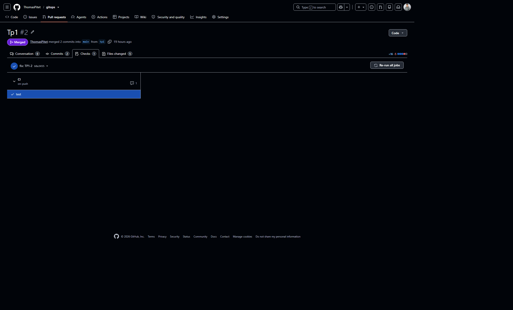
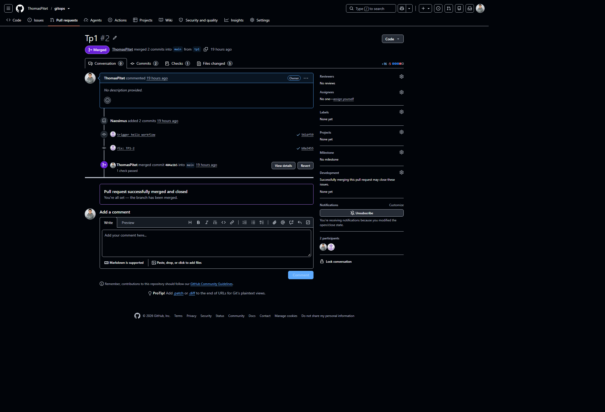
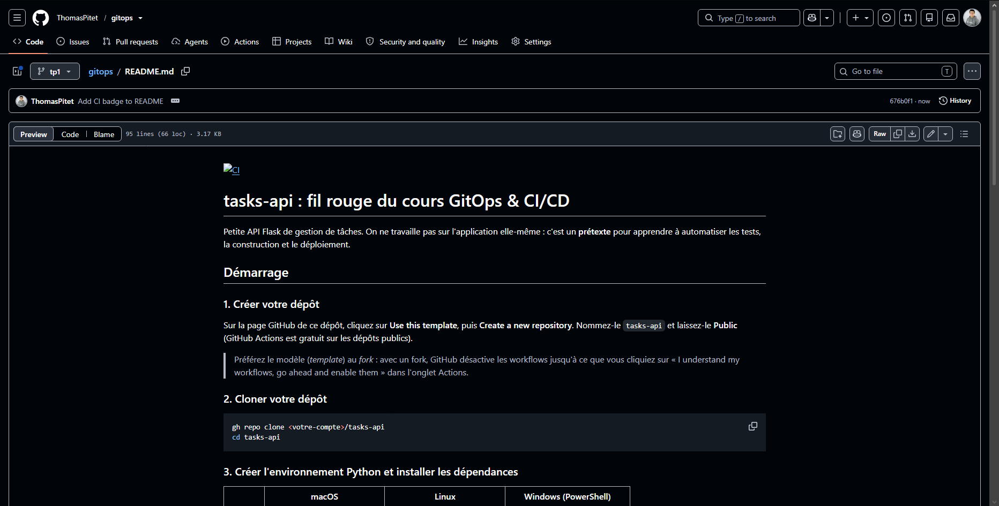

# TP1 — GitHub Actions : CI/CD

---

## Partie 1 : Hello Actions

📸 **TP1-1 :** Run « Hello » réussi

**Combien de temps a duré le run ?**
La durée du run a été de 11 secondes.

**Où voit-on les logs de chaque étape ?**
En cliquant sur un run dans l'onglet Actions, puis en dépliant chaque étape pour voir ses logs détaillés.

---

## Partie 2 : Lancer les tests automatiquement

📸 **TP1-2 :** Run `ci.yml` réussi avec les étapes visibles

---

## Partie 3 : Casser, observer, réparer

📸 **TP1-3 :** Run rouge avec l'erreur pytest visible

**Quel test a échoué ?**
`test_normalize_title_trims_and_capitalizes` le test qui vérifie que `normalize_title()` met bien la première lettre en majuscule et supprime les espaces superflus.

**À quelle ligne ?**
La ligne pointée par pytest dans le rapport d'erreur, typiquement la ligne de l'`assert` dans le fichier de test par exemple `assert result == "Ma tache"`.

**Qu'est-ce qui a permis de le trouver rapidement ?**
Le rapport de pytest : il affiche directement le nom du test, la ligne exacte qui a échoué, et la différence entre la valeur attendue et la valeur obtenue pas besoin de chercher dans le code.

📸 **TP1-4 :** Run vert après correction

---

## Partie 4 : Pull request et badge

📸 **TP1-5 :** PR avec les checks verts avant fusion

📸 **TP1-6 :** PR fusionnée

📸 **TP1-7 :** README avec le badge CI affiché

**Pourquoi attend-on que la CI soit verte avant de fusionner ?**

Pour garder la branche `main`stable et éviter d'y fusionner du code cassé.

