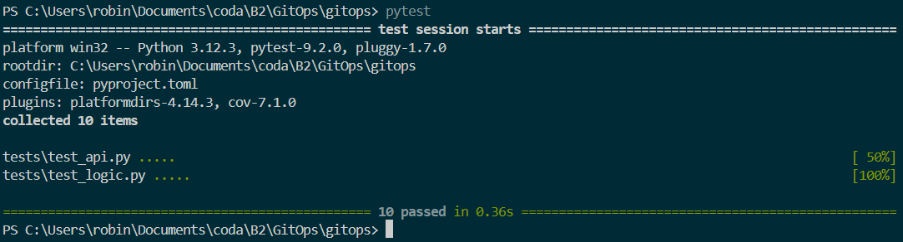
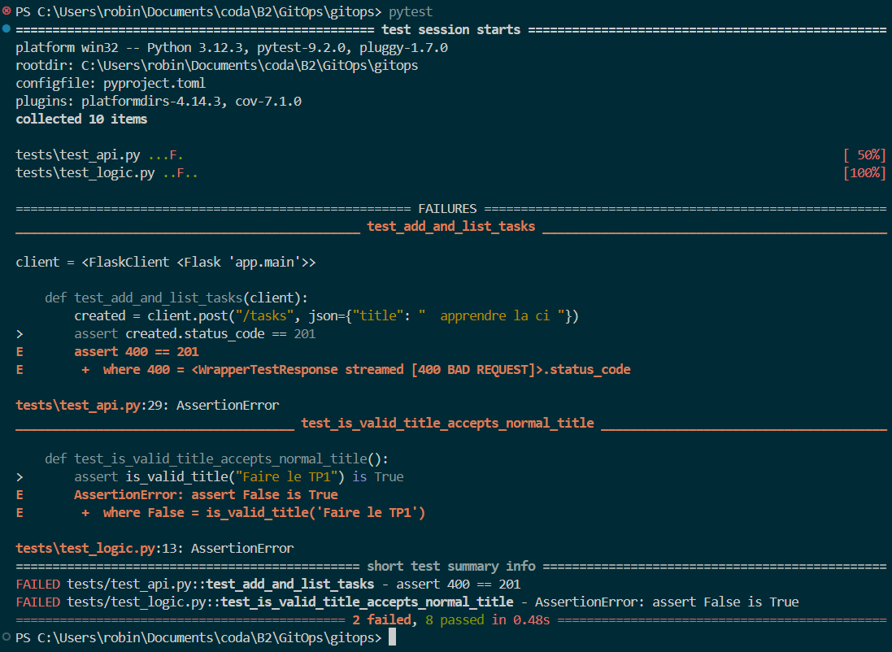

Combien de temps a duré le run ? Où voit-on les logs de chaque étape ?

la durée du run a durée 11 seconde

**Quel test a échoué ?**

 `test_normalize_title_trims_and_capitalizes`— le test qui vérifie que `normalize_title()`met bien la première lettre en majuscule et supprime les espaces superflus.

**À quelle ligne ?**

 La ligne pointée par pytest dans le rapport d'erreur, typiquement la ligne de l'`assert`dans le fichier de test — par exemple `assert result == "Ma tache"`.

**Qu'est-ce qui a permis de le trouver rapidement ?**

 Le rapport de pytest : il affiche directement le **nom du test**, la **ligne exacte**qui a échoué, et la **différence**entre la valeur attendue et la valeur obtenue (`AssertionError: assert "ma tache" == "Ma tache"`). Pas besoin de chercher dans le code.
