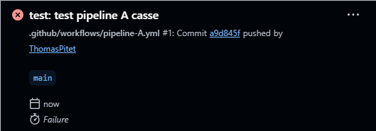
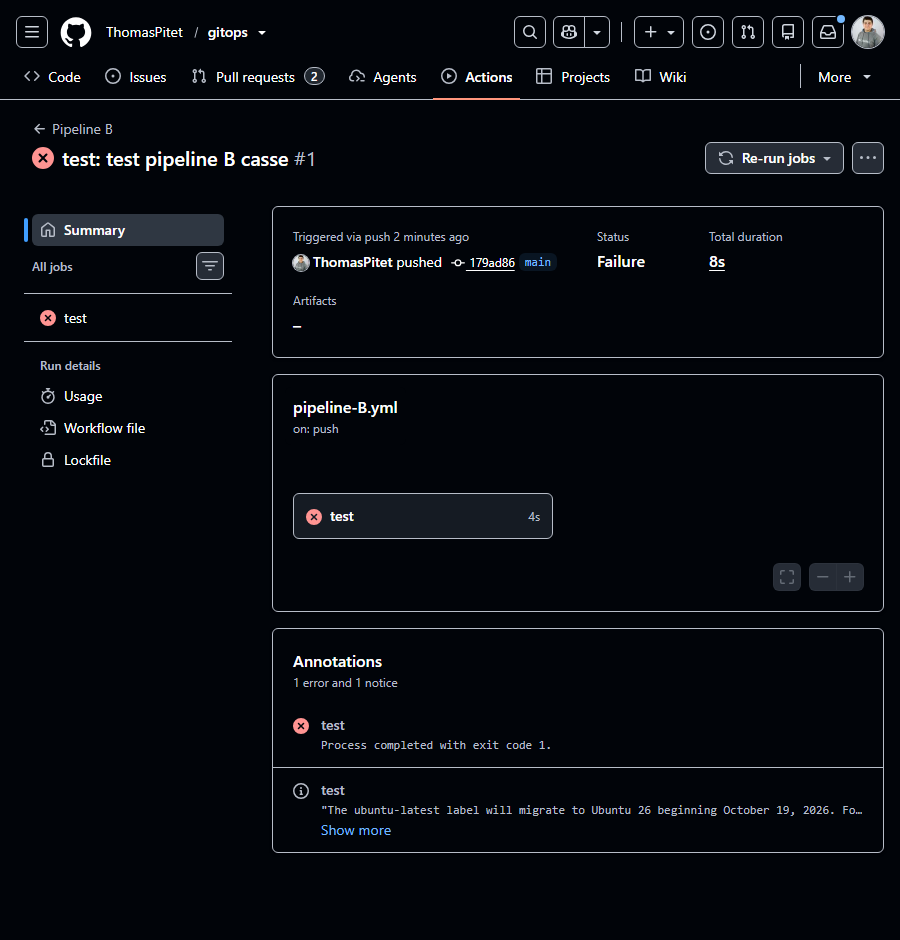
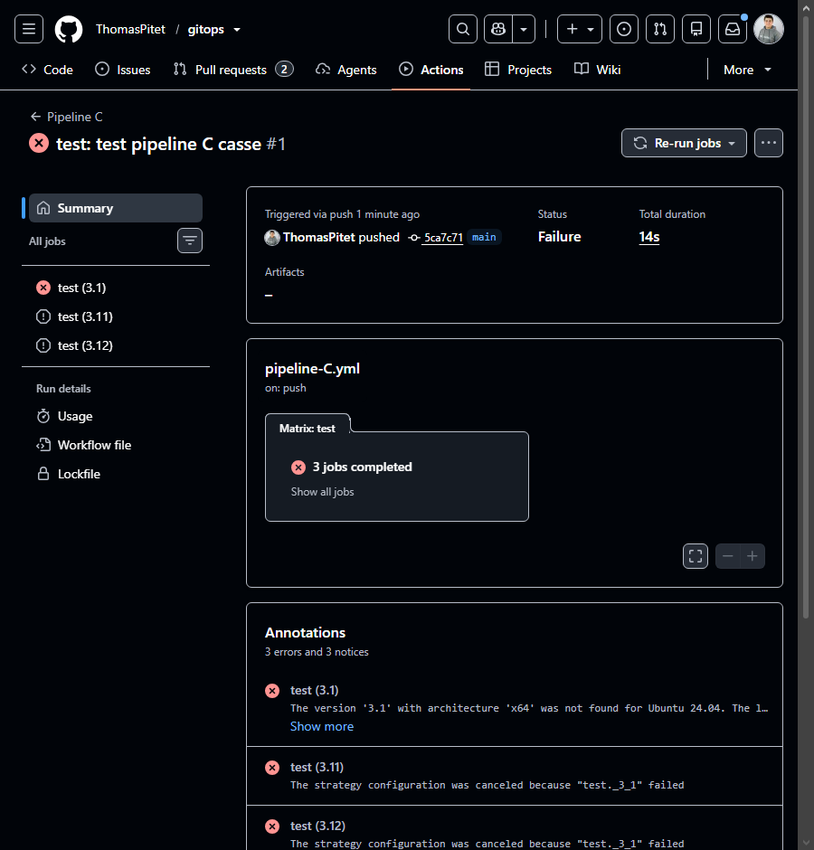

# TP2 — Une CI solide

---

## Partie 1 : Qualité automatique

📸 **TP2-1 :** Run vert avec les deux jobs `lint` et `test`

📸 **TP2-2 :** Job `lint` rouge avec le message d'erreur de flake8

**Questions :**

* **Flake8 (linter) :** vérifie les erreurs de code et de style (ex : variables inutilisées).
* **Black (formateur) :** reformate automatiquement l'agencement du code (espaces, retours à la ligne).
* **Pourquoi 2 jobs séparés ?** Pour les exécuter en parallèle et identifier immédiatement si le problème vient du style (`lint`) ou du fonctionnement (`test`).

---

## Partie 2 : Matrix, cache et artefact

📸 **TP2-3 :** Liste des 3 jobs de la matrice (`test (3.11)`, `test (3.12)`, `test (3.13)`)

📸 **TP2-4 :** Cache restauré et section Artifacts

**Questions :**

* **Pourquoi tester sur plusieurs versions de Python ?** Pour s'assurer de la compatibilité du code avec les différents environnements.
* **Que gagne-t-on avec le cache ?** Du temps et de la bande passante : les dépendances (`pip`) ne sont pas re-téléchargées à chaque run.
* **Un artefact, c'est quoi ?** Un fichier ou dossier produit pendant le workflow (ex. rapport de couverture) sauvegardé sur GitHub pour consultation ultérieure.

---

## Partie 3 : Protéger la branche main

📸 **TP2-5 :** Règle de protection de la branche `main` avec vérifications obligatoires

📸 **TP2-6 :** PR bloquée par une vérification en échec

**Question :**

* **Pourquoi interdire de pousser directement sur `main` ?** Pour protéger la branche de production contre le code cassé, et forcer le passage par la CI et la revue de code.

---

## Partie 4 : Pull request croisée et conflit

📸 **TP2-7 :** PR avec le message de conflit

📸 **TP2-8 :** Fichier `CHANGELOG.md` final contenant les deux lignes résolues

**Questions :**

* **Pourquoi Git ne peut pas résoudre seul ?** La même ligne a été modifiée des deux côtés : seul un humain peut choisir quoi garder.
* **Qu'est-ce qui a vérifié le code ?** Le pipeline de CI en relançant les tests automatiques.

---

## Partie 5 : Un secret dans le pipeline

📸 **TP2-9 :** Logs du workflow avec le secret masqué par `***`

**Questions :**

* **Pourquoi GitHub masque-t-il le secret ?** Pour empêcher les fuites accidentelles de mots de passe ou tokens dans les logs.
* **Que se passe-t-il si on le commite dans le dépôt ?** Il devient public et gravé dans l'historique Git ; il faut immédiatement le révoquer.
* **Secret ou variable : comment choisir ?** Secret pour les données confidentielles (mots de passe, tokens) ; Variable pour la configuration publique (nom d'environnement, URLs).

---

## Partie 6 : Trois pipelines à réparer

### TP2-10 : Runs en échec

📸 **TP2-10A :** Pipeline A en échec (erreur de syntaxe YAML / indentation)

📸 **TP2-10B :** Pipeline B en échec (checkout manquant, fichier `requirements-dev.txt` introuvable)

📸 **TP2-10C :** Pipeline C en échec (version Python `3.10` interprétée en flottant `3.1`)

### TP2-11 : Pipelines réparés au vert

📸 **TP2-11 :** Liste des runs montrant les 3 pipelines au vert

**Questions :**

* **Pipeline A :**
  * *Bug :* Espace en trop
  * *Détection :* Erreur de parsing affichée par GitHub Actions avant même le lancement.
  * *Prévention :* Utiliser un linter YAML dans l'éditeur de code.
* **Pipeline B :**
  * *Bug :* Étape `actions/checkout` manquante.
  * *Détection :* Erreur `requirements-dev.txt not found` dans les logs de `pip install`.
  * *Prévention :* Se rappeler qu'un runner démarre sur une machine vide sans code.
* **Pipeline C :**
  * *Bug :* `3.10` écrit sans guillemets, interprété comme le nombre `3.1`.
  * *Détection :* Échec de `setup-python` cherchant la version 3.1.
  * *Prévention :* Toujours mettre les numéros de version entre guillemets (`"3.10"`).
