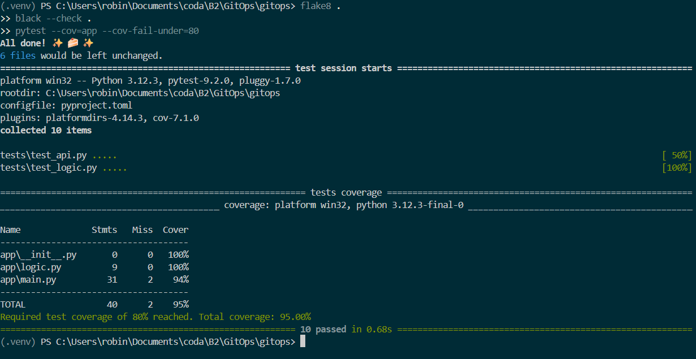
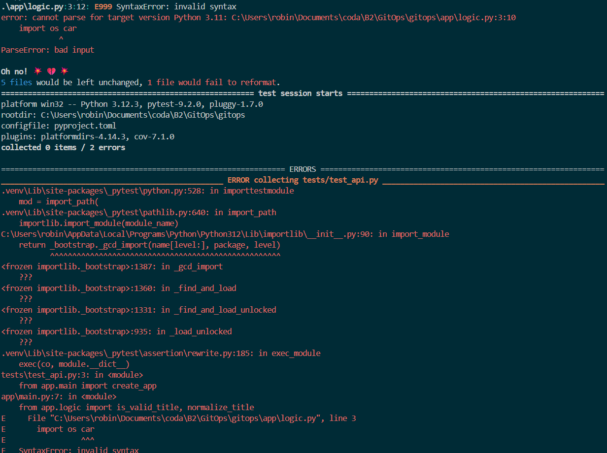
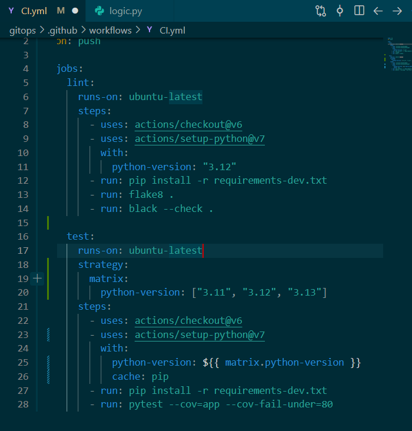

**Questions :** Quelle différence entre un linter (flake8) et un formateur (black) ? Pourquoi séparer `lint` et `test` en deux jobs ?

* **Flake8 (linter) :**vérifie les erreurs de code et de style (ex : variables inutilisées).
* **Black (formateur) :**reformate automatiquement l'agencement du code (espaces, retours à la ligne).

**Pourquoi 2 jobs séparés ?**

 Pour les exécuter en parallèle et identifier immédiatement si le problème vient du style (`lint`) ou du fonctionnement (`test`).

* **Pourquoi tester sur plusieurs versions de Python ?**

  Pour s'assurer de la **compatibilité**du code : vérifier qu'il fonctionne chez tous les utilisateurs et serveurs, sans bugs liés aux changements entre versions de Python.

  * **Que gagne-t-on avec le cache ?**

  Du **temps**et de la **bande passante**: les dépendances (`pip`) ne sont pas re-téléchargées à chaque run, ce qui accélère la CI.

  * **Un artefact, c'est quoi ?**

  Un **fichier ou dossier produit**pendant le workflow (ex. rapport de couverture, build, binaire) qui est **sauvegardé sur GitHub**pour être consulté ou téléchargé après l'exécution.
