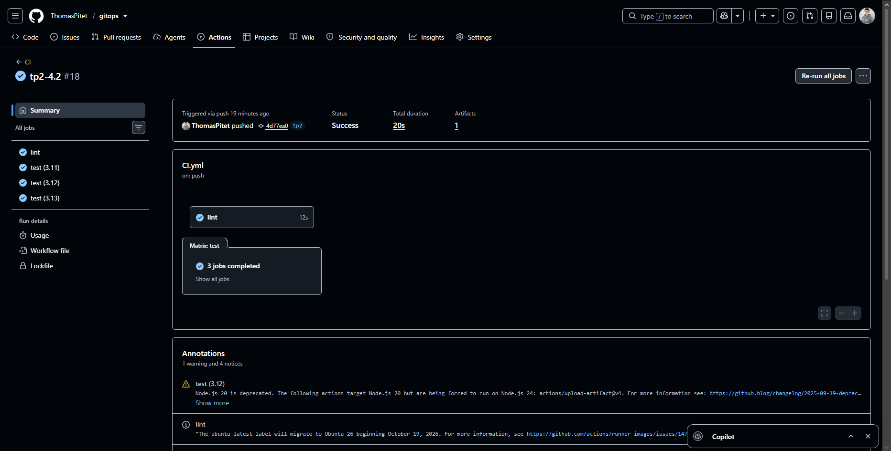
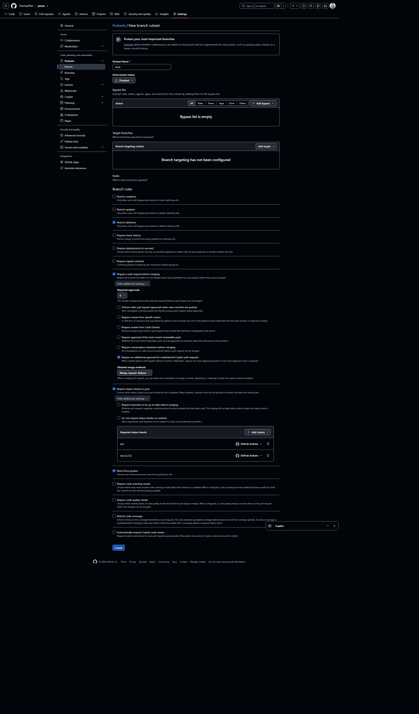
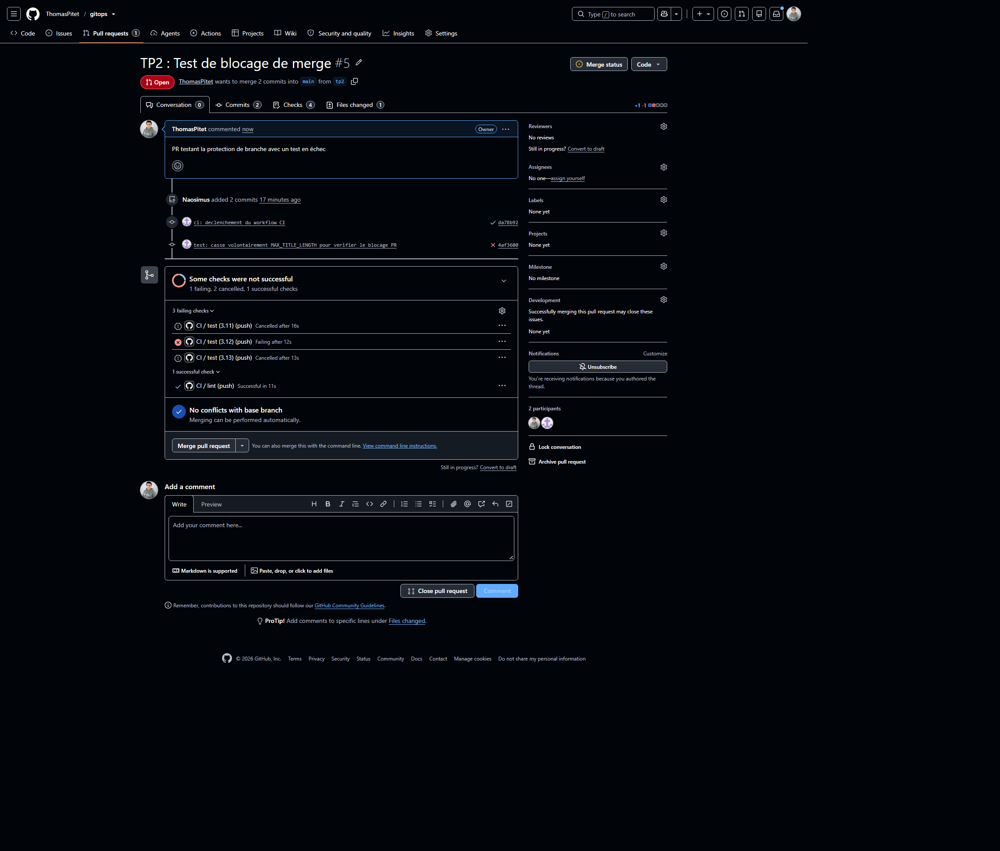
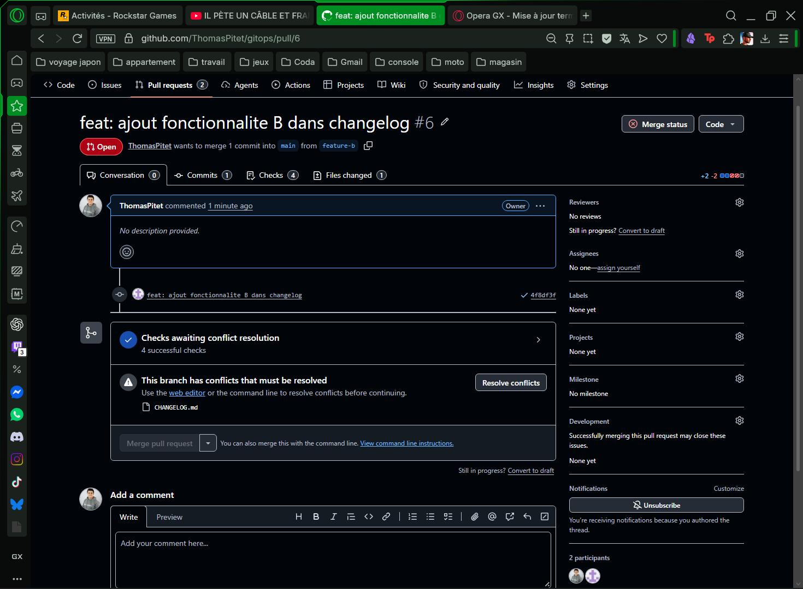
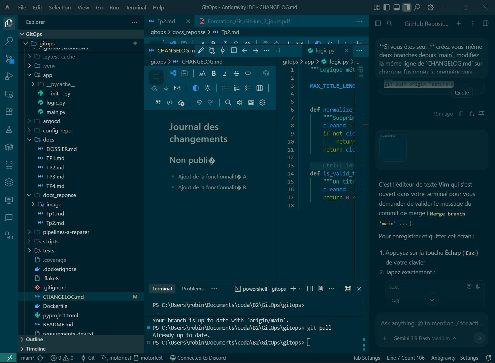
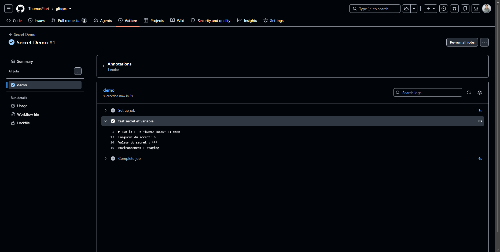

**Questions :** Quelle différence entre un linter (flake8) et un formateur (black) ? Pourquoi séparer `lint` et `test` en deux jobs ?

* **Flake8 (linter) :**vérifie les erreurs de code et de style (ex : variables inutilisées).
* **Black (formateur) :**reformate automatiquement l'agencement du code (espaces, retours à la ligne).

**Pourquoi 2 jobs séparés ?**

 Pour les exécuter en parallèle et identifier immédiatement si le problème vient du style (`lint`) ou du fonctionnement (`test`).

* **Pourquoi tester sur plusieurs versions de Python ?**

  Pour s'assurer de la **compatibilité**du code : vérifier qu'il fonctionne chez tous les utilisateurs et serveurs, sans bugs liés aux changements entre versions de Python.

  * **Que gagne-t-on avec le cache ?**

  Du **temps**et de la **bande passante**: les dépendances (`pip`) ne sont pas re-téléchargées à chaque run, ce qui accélère la CI.

  * **Un artefact, c'est quoi ?**

  Un **fichier ou dossier produit**pendant le workflow (ex. rapport de couverture, build, binaire) qui est **sauvegardé sur GitHub**pour être consulté ou téléchargé après l'exécution.
  

**Question :** Pourquoi interdire de pousser directement sur `main` ?

Pour protéger la branche de production contre le code cassé, et forcer le passage par la CI et la revue de code avant toute fusion.

* **Pourquoi Git ne peut pas résoudre seul ?**

  La même ligne a été modifiée des deux côtés : seul un humain peut choisir quoi garder.

  * **Qu'est-ce qui a vérifié le code ?**

  Le pipeline de CI en relançant les tests automatiques.

* **Pourquoi GitHub masque-t-il le secret ?**

  Pour éviter toute fuite accidentelle d'informations sensibles dans les logs visibles par d'autres personnes.

  * **Que se passe-t-il si on le commite dans le dépôt ?**

  Il devient visible par tous et reste gravé dans l'historique Git, il faut immédiatement le révoquer.

  * **Secret ou variable : comment choisir ?**
  * Secret : pour toute donnée sensible ou confidentielle
  * Variable : pour les configurations non secrètes
