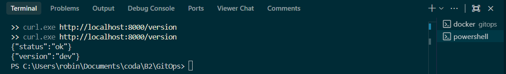
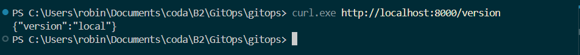

**Question :** Que gagne-t-on à décrire le lancement dans un fichier plutôt que dans une longue commande ?

toute la configuration est centralisée et versionnée dans Git, évitant les erreurs de frappe et permettant de tout démarrer avec une seule commande.
