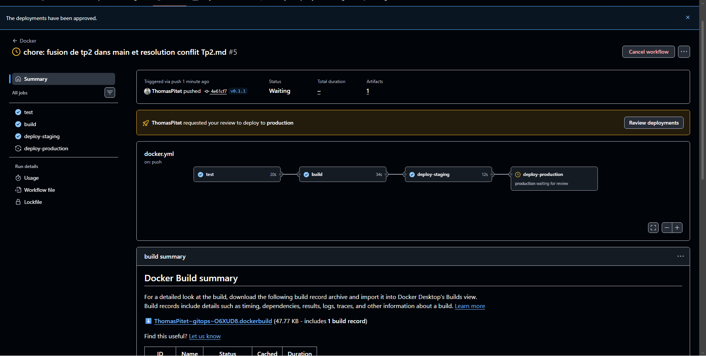
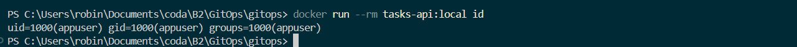

# TP3 — Docker et livraison continue

---

## Partie 1 : Votre Dockerfile

📸 **TP3-1 :** Construction de l'image locale et test `curl /health`

**Questions :**

* **Différence entre une image et un conteneur ?**
  * *Image :* modèle figé en lecture seule (le patron).
  * *Conteneur :* instance en cours d'exécution de cette image.
* **À quoi sert le `.dockerignore` ?**
  À exclure les fichiers inutiles ou sensibles (`.git`, `.venv`) pour alléger l'image et sécuriser le build.

---

## Partie 2 : Docker Compose

📸 **TP3-2 :** `docker compose up` en cours et appel sur `/version`

**Question :**

* **Que gagne-t-on à décrire le lancement dans un fichier plutôt que dans une longue commande ?**
  Toute la configuration est centralisée et versionnée dans Git, évitant les erreurs de frappe et permettant de tout démarrer avec une seule commande.

---

## Partie 3 : Publier l'image depuis le pipeline

📸 **TP3-3 :** Exécution du workflow `Docker` sur GitHub Actions

📸 **TP3-4 :** Image publiée sur GitHub Packages (GHCR)

**Questions :**

* **Pourquoi `build` attend-il `test` ?**Pour éviter de compiler et publier une image contenant des bugs si les tests échouent : on ne livre que du code vérifié.
* **Pourquoi éviter le tag `latest` en production ?**
  Parce qu'il n'est pas figé : son contenu change à chaque build, ce qui empêche d'identifier la version exacte et rend le rollback impossible.

---

## Partie 4 : Une release par un tag Git

📸 **TP3-5 :** Liste des tags du package (`0.1.0` et `sha-...`)

📸 **TP3-6 :** `docker run` de l'image téléchargée depuis GHCR et réponse `/version` (`0.1.0`)

**Question :**

* **Quel est l'avantage d'une image versionnée par rapport à « le code de ma machine » ?**
  Elle garantit que l'application tourne exactement de la même manière partout, sans dépendre de la configuration ou des fichiers locaux de votre machine.

---

## Partie 5 : Environnements et approbation

📸 **TP3-7 :** Workflow avec approbation requise pour l'environnement `production`

**Questions :**

* **Test de fumée :** vérifier en quelques secondes que l'application démarre et répond sur ses routes de base.
* **Approbation humaine :** garder le contrôle final et valider que tout est stable avant d'impacter les vrais utilisateurs.

---

## Partie 6 : Sécurité de l'image

📸 **TP3-8 :** Sortie de la commande `id` dans le conteneur (utilisateur non-root)

**Question :**

* **Pourquoi ne pas exécuter une application en root dans un conteneur ?**
  Pour limiter les risques de sécurité : si un attaquant compromet l'application, il n'aura pas les droits administrateur (root) sur la machine hôte.
