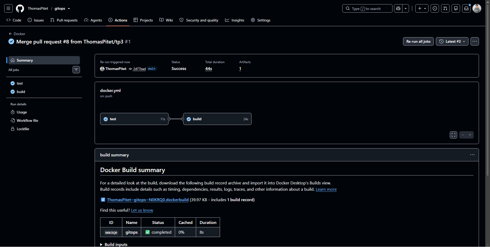
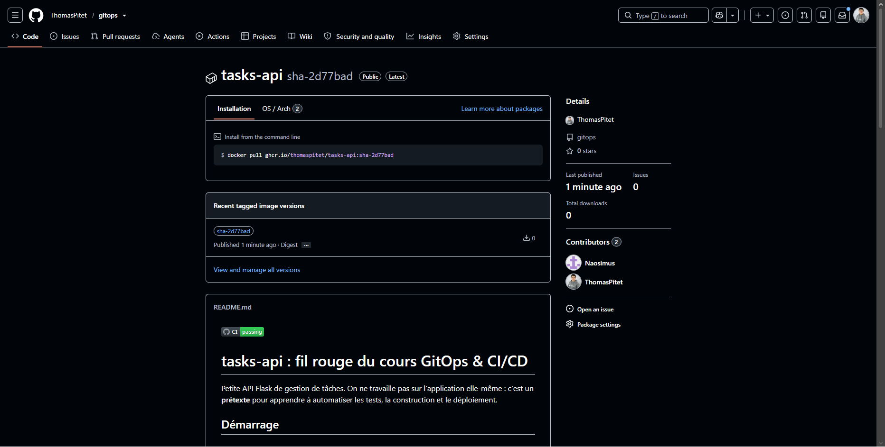
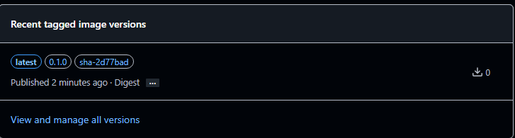
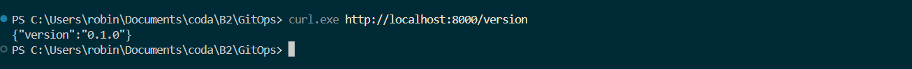

**Question :** Que gagne-t-on à décrire le lancement dans un fichier plutôt que dans une longue commande ?

toute la configuration est centralisée et versionnée dans Git, évitant les erreurs de frappe et permettant de tout démarrer avec une seule commande.

**Questions :** Pourquoi `build` attend-il `test` ? Pourquoi éviter le tag `latest` en production ?

* **Pourquoi `build` attend-il `test` ?**

  Pour éviter de compiler et publier une image contenant des bugs si les tests échouent : on ne livre que du code vérifié et fonctionnel.

  * **Pourquoi éviter le tag `latest` en production ?**

  Parce qu'il n'est pas figé : son contenu change à chaque nouveau build, ce qui empêche de savoir exactement quelle version tourne et rend impossible tout retour arrière (rollback) fiable.

**Question :** Quel est l'avantage d'une image versionnée par rapport à « le code de ma machine » ?

Elle garantit que l'application tourne exactement de la même manière partout, sans dépendre de la configuration ou des fichiers locaux de votre machine.
