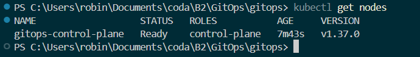
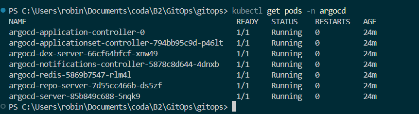
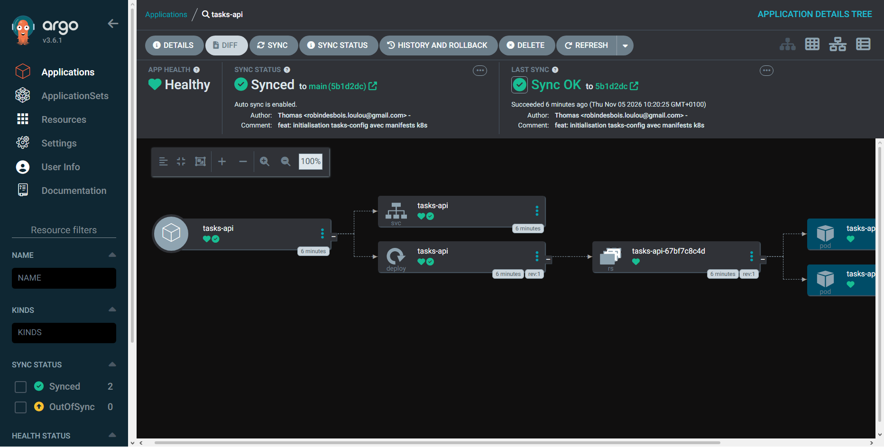
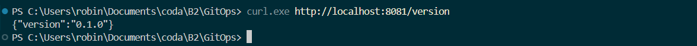
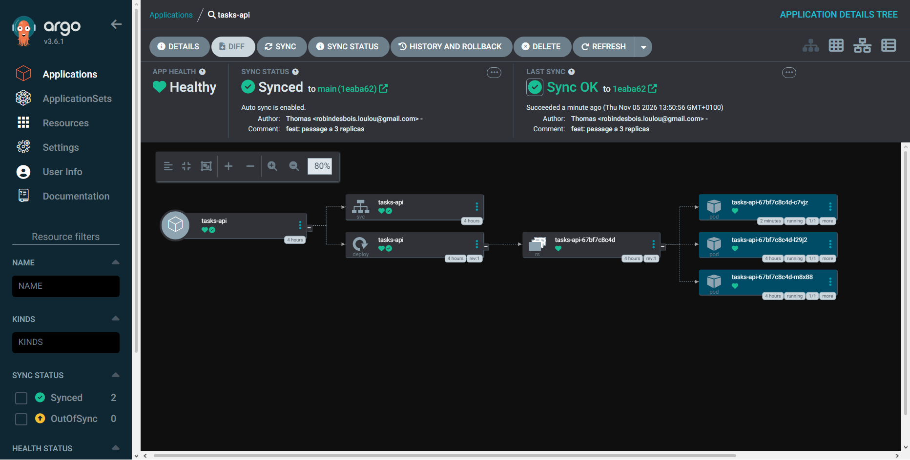
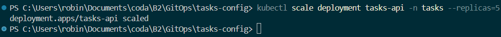
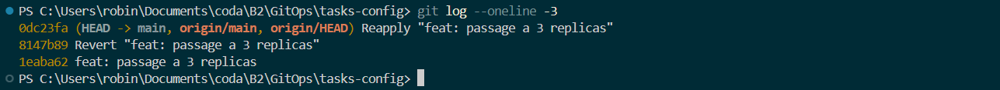
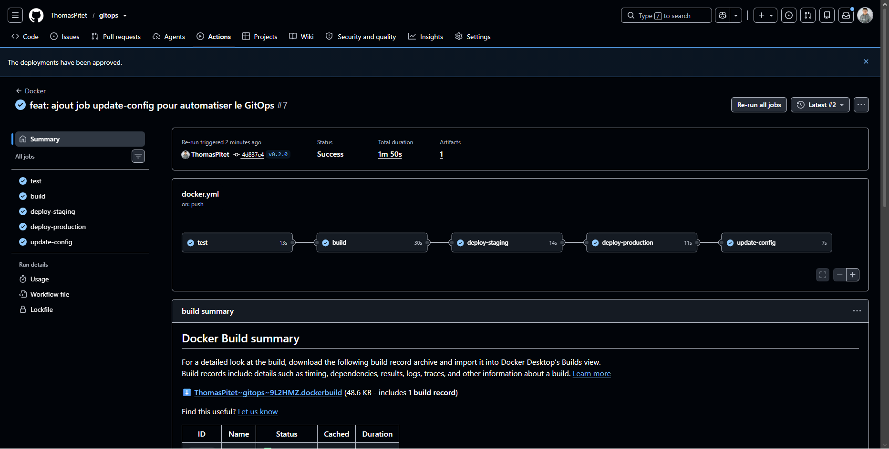
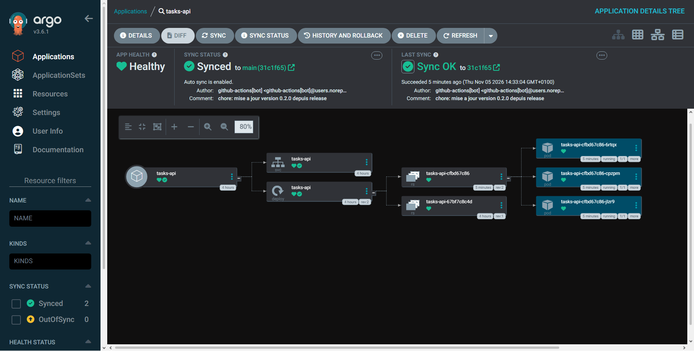
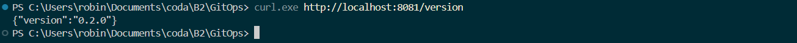

# TP4 — GitOps avec Argo CD

---

## Partie 1 : Cluster et Argo CD

📸 **TP4-1 :** Nœud du cluster Kind au statut `Ready`

📸 **TP4-2 :** Pods Argo CD en cours d'exécution et mire de connexion

**Questions :**

* **Un Pod :** La plus petite unité de Kubernetes, qui enveloppe et exécute un ou plusieurs conteneurs.
* **Un Deployment :** Le contrôleur qui gère les Pods (définit les répliques, les mises à jour et la résilience).
* **Un Namespace :** Un compartiment virtuel qui isole et organise les ressources au sein du cluster.

---

## Partie 2 : Le dépôt de configuration

📸 **TP4-3 :** Application `tasks-api` dans Argo CD (Synced et Healthy avec 2 pods)

📸 **TP4-4 :** Réponse de l'API `/version` déployée dans le cluster (`0.1.0`)

**Question :**

* **Pourquoi sépare-t-on le dépôt de l'application et le dépôt de configuration ?**
  * **Séparation des responsabilités :** les développeurs gèrent le code applicatif, tandis que les ops/Argo CD gèrent l'infrastructure et le déploiement.
  * **Éviter les boucles infinies de CI :** modifier un tag ou un manifeste ne doit pas relancer les tests unitaires et la compilation de l'image.
  * **Sécurité :** permet de restreindre finement les droits d'accès à la configuration de production.

---

## Partie 3 : Le GitOps en action

📸 **TP4-5 :** Commit `replicas: 3` et les 3 pods visibles dans Argo CD

📸 **TP4-6 :** Détection de la dérive après `kubectl scale` et auto-guérison (`selfHeal`)

📸 **TP4-7 :** Historique Git avec le `revert` et retour automatique à 2 pods

**Questions :**

* **Que signifie `selfHeal` ?**
* Argo CD écrase automatiquement toute modification manuelle faite sur le cluster
* **Pourquoi le retour arrière est-il simple en GitOps ?**
* Il suffit d'annuler le commit dans Git pour qu'Argo CD redéploie instantanément l'ancienne version

---

## Partie 4 : La chaîne complète

📸 **TP4-8 :** Run complet avec tous les jobs au vert, incluant `update-config`

📸 **TP4-9 :** Commit automatique dans `tasks-config` et synchronisation Argo CD sur `0.2.0`

📸 **TP4-10 :** Réponse `/version` affichant `0.2.0`

**Questions :**

* **Chemin d'un `git tag` jusqu'au pod :**
* Tag Git ➔ Build de l'image ➔ Commit automatique dans `tasks-config`➔ Argo CD tire le Git ➔ Déploiement des pods.
* **Qui pousse (push) et qui tire (pull) ?**
* La CI push dans Git, Argo CD pull depuis Git vers le cluster.
* **Différence avec un déploiement CI/CD « classique » :**
* En CI classique la pipeline pousse vers le cluster, en GitOps le cluster tire lui-même depuis Git.
